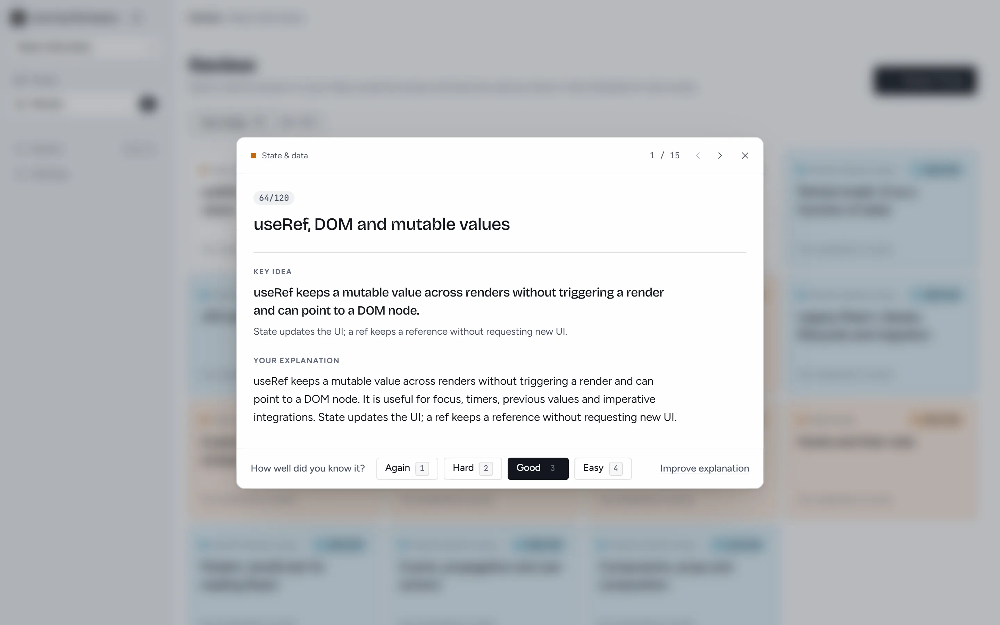

# KnowGraph

A study workspace for senior React and Rails interviews: 142 concepts in a dependency graph, each studied by reading it, explaining it in your own words and having an LLM you bring grade the explanation. Open source, and it runs on your machine.

**[Download for Windows](https://github.com/Felichz/KnowGraph/releases/latest)** · [Demo video](https://know-graph.vercel.app) · [Run from source](#run-it) · [Case study](https://portfolio-felix-teal.vercel.app/work/knowgraph/) · Author: [Felix Andersson](https://portfolio-felix-teal.vercel.app/)

There is no hosted version. The mentor, the coach and the grader all need a language model, and KnowGraph doesn't ship or pay for one: you run the app (as a desktop app or a local dev server) and connect your own provider, or a fully local model through Ollama or LM Studio. [know-graph.vercel.app](https://know-graph.vercel.app) is a demo page with a walkthrough video and the download links.

<picture>
  <source media="(prefers-color-scheme: dark)" srcset="docs/screenshots/knowgraph-demo-dark.webp">
  
</picture>

## What it is

I built KnowGraph to prepare for my own senior interviews. The curriculum is two graphs: React (101 concepts, 212 prerequisite links, 11 focus areas, 16 milestones, 4 seniority levels) and Rails (41 concepts, 54 links). A link means one concept gives you the mental model for the next; it suggests an order but never blocks you from studying something out of sequence. The interface is in English by default, with a Spanish version (EN / ES switcher; the curriculum and the AI answers follow the selected language), and still uses the project's working title, Learning Workspace.

Every concept is studied along one path: **Read** the card (explanation, naive vs. senior code, pitfalls, sources, optional read-aloud), **Explain** it from memory with dictation and a coach that marks covered ideas when you pause, then **Evaluate**, with a Socratic **Mentor** one click away at any point. The evaluation: an LLM grades the explanation against a four-part rubric (accuracy, causality and trade-offs, application, completeness). Scores run from 0 to 120. Up to 100 measures coverage of the essential material; 101-120 is a separate excellence tier that only opens after full coverage, to push back on the grade inflation LLMs tend toward ([ADR 0006](docs/adr/0006-dual-tier-evaluation-scale-0-120.md)). Everything is local-first and bring-your-own-key. The app has two places, Study and Review: Study opens on one next step (resume what you started or the best next concept) above a heat grid where every concept is a cell that fills with its area's color as you master it, and Review runs flashcards on spaced repetition so worked concepts come back right before you would forget them.

<table>
  <tr>
    <td width="50%" valign="top">
      <picture>
        <source media="(prefers-color-scheme: dark)" srcset="docs/screenshots/knowgraph-card-dark.webp">
        
      </picture>
      <br><sub>Study session: Read, Explain, Evaluate. The mentor is one click away.</sub>
    </td>
    <td width="50%" valign="top">
      <picture>
        <source media="(prefers-color-scheme: dark)" srcset="docs/screenshots/knowgraph-graph-demo-dark.webp">
        
      </picture>
      <br><sub>Dependency graph. Hovering a concept lights its whole prerequisite chain.</sub>
    </td>
  </tr>
  <tr>
    <td colspan="2" align="center">
      <picture>
        <source media="(prefers-color-scheme: dark)" srcset="docs/screenshots/knowgraph-review-dark.webp">
        
      </picture>
      <br><sub>Review: reveal the answer, then rate it to schedule the next review.</sub>
    </td>
  </tr>
</table>

## How it's built

- **Headless core, React as the view.** `src/logic/learningController.js` is a framework-free store that React reads through `useSyncExternalStore` (`src/hooks/useController.js`). It replaced a single 2,642-line `App.jsx`, and its logic is tested in plain Node under `tests/logic/`. Files in the presentation layer (`src/ui/`) stay under 150 lines each. See [ADR 0005](docs/adr/0005-headless-state-machine-use-sync-external-store.md) and [ADR 0008](docs/adr/0008-strict-150-line-file-limit-and-ci-linter.md).
- **Rendering JSON while it streams.** The evaluation is structured JSON streamed over SSE. On the gateway, `server/ai/partialJson.js` and `server/ai/streamBlocks.js` scan the incomplete JSON and emit finished fields and growing text leaves as separate events, so rubric bars and feedback fill in while the model is still writing. The score comes from a small request without reasoning, sent before the longer feedback request (`server/ai/evaluator.js`), and Zod validates every final object (`server/ai/schemas.js`). The browser reads the stream with `fetch` and a `ReadableStream` reader in `src/ai/client.js`.
- **Bring-your-own-key gateway.** One Node handler (`server/index.js`) runs as a local process or as a child process of the Electron app (it can also be mounted as a serverless function, `api/ai/[...slug].js`, for self-hosting). The user's provider profile travels with each request, is validated with Zod and is never written to disk or logged. When deployed publicly the gateway only accepts HTTPS endpoints that resolve to public IPs (`server/ai/providers.js`). Any OpenAI-compatible Chat Completions endpoint works; the presets live in `shared/providerCatalog.js`. See ADRs [0001](docs/adr/0001-llm-provider-registry.md) to [0004](docs/adr/0004-user-owned-local-harness-and-desktop-electron.md).
- **Local-first storage.** Attempts, drafts and live reviews are stored in IndexedDB through `idb` (`src/ai/learningStore.js`); preferences, provider connections and the flashcard review schedule sit in `localStorage`. There is no account and no remote database. A JSON backup exports and restores all of it, saved provider keys included (`src/ai/backup.js`).
- **Work that outlives the screen.** `src/ai/backgroundTaskManager.js` keeps evaluations running after you leave the card, reports them in a global HUD with open and cancel actions (`src/ui/hud/TaskHud.jsx`), and syncs them across tabs with `BroadcastChannel`.
- **Graph layout without D3.** `src/logic/topologicalLayout.js` ranks concepts with Kahn's algorithm (tolerating cycles), then runs eight barycenter sweeps to reduce edge crossings. The result is plain SVG with pan and zoom (`src/ui/graph/`).

## Stack

React 19 and Vite 6 in plain JavaScript (no TypeScript) · hand-written CSS on design tokens (`src/ui/theme/tokens.css`, with the light edition in `light.css`; the system setting picks one until you choose) · Bricolage Grotesque, Figtree and JetBrains Mono · Mermaid (lazy-loaded) and Prism for diagrams and code · Node gateway with Zod and server-sent events · IndexedDB via `idb` · Web Speech API for read-aloud and dictation · Playwright · Electron for the desktop build · a static demo page on Vercel (`site/`).

## Run it

### Windows installer

Download `KnowGraph-Setup-<version>.exe` (or the portable `.zip`) from the [latest release](https://github.com/Felichz/KnowGraph/releases/latest). The installer is not code-signed yet, so Windows SmartScreen asks for confirmation the first time (*More info → Run anyway*).

### From source (Windows, macOS, Linux)

Requires Node.js 20+ and npm.

```bash
git clone https://github.com/Felichz/KnowGraph.git
cd KnowGraph
npm install
npm install --prefix server
npm run desktop:dev        # Electron window; starts the AI gateway on 127.0.0.1:4317 if it isn't running
```

Or in the browser, with the gateway in a second terminal:

```bash
npm start --prefix server  # AI gateway on http://127.0.0.1:4317
npm run dev                # http://localhost:5173, proxies /api/ai to the gateway
```

### Connect a model

Open **Settings → AI connections** and add a provider: OpenAI, OpenRouter, Groq, Mistral, DeepSeek, MiniMax and the other presets, any OpenAI-compatible endpoint, or a local model through Ollama or LM Studio. The key stays on your machine and travels with each request to the local gateway; it is never written to disk by the gateway or logged. The map, the cards, the graph and Review work without a model; the mentor, the coach and the evaluation need one.

The gateway needs no configuration. Optional variables in `server/.env` (copy `server/.env.example`):

| Variable | Purpose |
| --- | --- |
| `MINIMAX_API_KEY`, `MINIMAX_MODEL` | Default provider for requests that carry no profile of their own. |
| `FREELLMAPI_BASE_URL`, `FREELLMAPI_API_KEY` | Fallback for the default provider. Never used for a request that brings its own key. |
| `CORS_ALLOWED_ORIGINS` | Comma-separated origins allowed to call the gateway. |
| `ALLOW_PRIVATE_PROVIDER_URLS` | Allows local or LAN endpoints. On by default outside production. |

If you self-host the web build, `VITE_AI_API_URL` (root `.env.example`) points the frontend at a gateway on another origin; leave it empty when they share one. See [docs/DEPLOY_VERCEL.md](docs/DEPLOY_VERCEL.md).

### Checks and builds

| Command | What it does |
| --- | --- |
| `npm run test:logic` | Headless tests for the controller, layout, provider settings, background tasks and more. |
| `npm run build && npm run test:e2e` | 48 Playwright tests across 7 specs, run against the built app with the gateway. Set `PW_CHANNEL=msedge` (or `chrome`) to use an installed browser instead of Playwright's download. |
| `npm run check` | Content audit of the React graph (`npm run audit:react`), the i18n parity check (`npm run check:i18n`) and a production build. |
| `npm run desktop:dev` | Opens the app in Electron, starting the gateway if it isn't running. |
| `npm run desktop:dist` | Builds the Windows installer and portable zip into `release/`. |
| `node scripts/audit-lines.mjs` | Checks the 150-line limit for every file under `src/ui/` and `src/hooks/`. |

## Project structure

```text
src/
  logic/        headless controller, selectors, graph registry, topological layout
  ai/           SSE client, background tasks, BYOK settings, IndexedDB store, backup
  ui/           presentation layer: shell, map, graph, study stages, flashcards, progress
  react*.js     React curriculum, composed from content layers
  lessons.js    Rails lesson content (graph in src/logic/railsGraph.js)
server/         AI gateway: routes, provider registry, prompts, Zod schemas, stream parsers
api/ai/         serverless mount of the same gateway, for self-hosting
site/           the static demo page served at know-graph.vercel.app
shared/         provider catalog used by both the UI and the gateway
electron/       desktop shell (window, local renderer server, gateway process)
tests/          logic suites, Playwright specs and state fixtures
specs/          product and design specs for each UI iteration
docs/           guides and architecture decision records
```

To add a React concept, start in `src/reactGraph.js`, with sources in `src/reactSources.js` and interview questions in `src/reactInterviewQuestions.js`; `npm run check` fails if a node is missing its explanation, code sample, steps, failure modes, HTTPS sources or valid prerequisites, or if its English text under `src/i18n/content/en/` is missing or out of date (`node scripts/i18n/extract-content.mjs` lists what to translate). Rails content lives in `src/lessons.js` and is registered in `src/logic/railsGraph.js`.

## Documentation

- [Architecture decision records](docs/adr/README.md): 10 ADRs on the provider registry, BYOK, the headless store, the 0 to 120 scale, the rubric and the working process.
- [PRODUCT.md](PRODUCT.md) and [DESIGN.md](DESIGN.md): product intent and the design system (v4.2, the heat grid).
- [specs/](specs/) and [AGENTS.md](AGENTS.md): one spec per UI iteration, latest [007, one obvious path](specs/007-obvious-path/design-spec.md), and the spec-driven workflow behind them.
- [LLM learning experience plan](docs/LLM_LEARNING_EXPERIENCE_PLAN.md) and [headless API handoff guide](docs/PRESENTATION_HANDOFF_GUIDE.md).
- [The desktop app](docs/DESKTOP_APP.md), and [the demo site and self-hosting](docs/DEPLOY_VERCEL.md).

Progress lives in the app's local storage (the Electron profile, or the browser's for the dev server), so clearing it resets your progress unless you exported a backup from Settings.

## License

[MIT](LICENSE).
